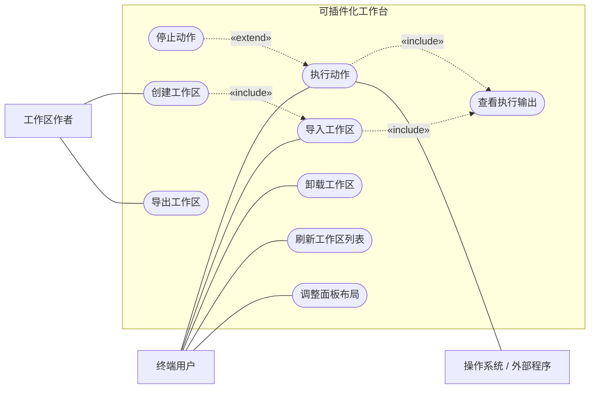

# 软件工程实践 Part 1 —— 需求分析报告

> **课程**：软件工程实践（Software Engineering Practices）· Part 1
> **项目**：可插件化工作台（Plugin Workbench）
> **组员 / 学号**：（待填）
> **日期**：（待填）

---

## Task 1：确认项目题目与类型（Verify the topic/title of the software project）

| 项 | 内容 |
|---|---|
| **项目标题（中文）** | **可插件化工作台** |
| **Project Title (English)** | **Plugin Workbench** |
| **项目类型** | **System**（软件系统）|
| **所属领域** | 开发者工具 / 自动化工具（Developer Tools / Automation）|
| **交付形态** | Windows 桌面软件（Electron）+ 自定义数据格式「工作区包」|

**一句话描述**

> 一个**可导入、可自定义的桌面工作台**：用户导入一份「**工作区包（Workspace Package）**」，工作台就长出由该工作区定义的**按钮**；点击按钮即**在本机执行对应脚本 / 命令**，输出实时显示在工作台内；工作区还可**打包分享**给他人，对方导入后立刻获得同样功能。

**术语说明（题目里的"插件"指什么）**

> 本项目的"插件"以「**工作区包**（Workspace Package）」为形态：一个文件夹 + `manifest.json`（声明名称、图标与动作列表）。
> **插件 = 形态，工作区 = 实例**，二者指同一件事。"可插件化"指的是：**工作台的功能可由外部数据定义并装载，无需修改工作台自身代码**。

**用户定位（谁写、谁用）**

| 角色 | 是谁 | 是否需要会写命令 |
|---|---|---|
| **工作区作者**（第一版的目标用户）| 编写工作区包的人 | **需要**——当前版本的内容由他们提供 |
| **终端使用者**（产品的最终方向）| 导入工作区、点击按钮的人 | **不需要**——只需导入与点击 |

> 因此，"面向开发者"说的是**供给端**（内容从哪来），"面向所有人"说的是**使用端**（导入即用，与专业无关）。详见 Task 2。

**为什么是 System（判断依据）**

结论：本项目产出**可运行、可用的软件系统**（界面、执行引擎、进程间通信、安全边界、自定义数据格式均已落地），因此在 Research / System / Games 三类中属于 **System**。

| 类型 | 特征 | 本项目是否符合 |
|---|---|---|
| Research（研究类）| 产出为研究问题、方法、实验与论证（论文式成果）| ❌ 本项目产出是**可运行的软件** |
| Games（游戏类）| 核心为可玩性与游戏机制 | ❌ 本项目是工具型生产力软件，无游戏性 |
| **System（系统类）** | 产出为**可运行、可用的软件系统** | ✅ 已具备完整系统要素：界面、执行引擎、进程间通信、安全边界、自定义数据格式 |

**补充**：本项目属于**平台型应用软件（Platform-type Application Software）**——它不只自身提供功能，还能承载**他人编写的工作区（插件）**，因此是"平台"而非单纯的"工具"。

---

## Task 2：定义客户的问题与项目范围（Define the customer's problem and the scope）

### 2.1 客户的问题（Customer's Problem）

**目标客户**：以**开发者 / 技术用户**为第一目标用户（后续扩展到普通办公用户）。

**现状与痛点**

| # | 痛点 | 具体表现 |
|---|---|---|
| P1 | **日常操作入口分散** | 常用操作散落为桌面快捷方式、`.bat` 脚本、命令行命令；每次都要"找文件、记路径、敲命令" |
| P2 | **命令与路径需要记忆** | 如把课件 Markdown 转 HTML，要敲一长串路径与参数，容易记错、反复复制粘贴 |
| P3 | **环境无法迁移** | 换电脑或重装系统后，整套个人工作流需要重建 |
| P4 | **工作流无法分享** | 想把"我的一套日常操作"交给同事或同学，只能口头讲解或发送一堆零散文件 |
| P5 | **命令行门槛** | 非技术用户不会写命令，只能依赖图形界面，但图形界面又无法自定义 |
| P6 | **执行过程不可见** | 直接双击脚本时会弹黑窗一闪而过，看不到输出、看不到成功与否 |

**问题陈述（Problem Statement）**

> 技术用户的日常操作以"脚本 / 命令"形式存在，但这些操作**缺乏统一入口、缺乏执行反馈、无法成套迁移与分享**；而现有图形化工具又**无法让用户自定义其功能**。因此需要一个**可由用户自行定义、可一键执行、且能打包分享**的工作台。

### 2.2 项目范围（Scope of the Project）

**范围内（In Scope，第一阶段）**

| 编号 | 内容 |
|---|---|
| S1 | **工作区包格式**：以文件夹（内含 `manifest.json`）定义工作区；声明名称、图标、说明、权限与动作列表 |
| S2 | **工作区装载**：扫描工作区目录、列出已安装工作区、支持刷新 |
| S3 | **内容区渲染**：按清单自动渲染动作按钮（图标、名称、将执行的命令、运行状态）|
| S4 | **真实执行**：点击按钮在**本机**执行对应命令，支持指定工作目录 |
| S5 | **输出回显**：标准输出 / 错误输出**实时流式**显示，带时间戳，错误高亮 |
| S6 | **执行控制**：单个停止与全部停止（结束整棵进程树）|
| S7 | **导入 / 导出 / 卸载**：导入工作区包前**列出该包将执行的全部命令供用户确认** |
| S8 | **界面外壳**：无边框窗口、可拖动分界线调整面板尺寸、按视觉规范统一风格 |

**范围外（Out of Scope，本阶段明确不做）**

| 编号 | 不做的事 | 原因 |
|---|---|---|
| N1 | 工作区市场 / 云同步 / 账号体系 | 依赖服务端与运营，属后续阶段 |
| N2 | 图形化工作区编辑器（拖拽建按钮）| 面向大众用户的功能，第二阶段再做 |
| N3 | 多步骤流水线、定时触发、远程执行 | 超出"本机一键执行"的核心价值 |
| N4 | 插件自带自定义界面（沙箱 iframe）| 属第三阶段，且需先完成权限模型 |
| N5 | macOS / Linux 打包 | 第一版聚焦 Windows，跨平台留待后续 |

---

## Task 3：描述项目背景（Describe the background）

### 3.1 领域背景

- **自动化与脚本化已成为技术工作者的日常**：批处理脚本（`.bat`）、PowerShell（`.ps1`）、Shell（`.sh`）、Python 脚本、`npm scripts` 等被广泛用于启动服务、生成产物、部署与日常维护。
- **"界面"与"权限"曾是互斥的**：网页（浏览器沙箱）无法执行本机命令，而传统桌面程序界面开发成本高。**Electron 类技术**（以 VS Code 为代表）让"用网页技术画界面 + 拥有完整本机权限"成为成熟方案，为本项目提供了技术可行性。
- **打包与分发成本大幅降低**：以文件夹 / 压缩包形式定义与分发数据（如 `.wsp` 包），无需应用商店或安装程序即可完成"能力"的传递。

### 3.2 现有方案及其不足（Background / Prior Art）

| 类别 | 代表 | 优势 | 不足 |
|---|---|---|---|
| 手动操作 | 桌面快捷方式、开始菜单 | 简单直接 | 无统一入口、无执行反馈、不可分享 |
| 脚本文件 | `.bat` / `.ps1` / `.sh` | 灵活、强大 | 要记路径与命令；散落各处；无法成套分享 |
| 任务运行器 | Make、just、Taskfile、npm scripts | 声明式、可版本管理 | 无图形界面、无分享生态、面向项目而非个人工作台 |
| 命令启动器 | Raycast、Alfred、PowerToys Run | 唤出快、可自定义命令 | 缺少"可导入的工作区"这一**成套能力单元** |
| 可编程按钮面板 | Elgato Stream Deck、AutoHotkey、Keyboard Maestro | 按钮自定义能力强 | 绑定硬件或特定平台，配置**无法跨人分享** |
| 编辑器扩展 | VS Code tasks / extensions | 能力强、生态好 | **被困在编辑器内部**，无法作为独立工作台 |
| 本地自动化平台 | Home Assistant、n8n、Node-RED | 插件化与流程编排成熟 | 面向 IoT / 数据流，**不是"本机脚本启动台"** |
| 脚本合集网站 | 各类脚本分享站 | 资源多 | **只收集、不执行、不可定制** |

### 3.3 机会点（Gap）

> 上述方案**各自解决了问题的一部分，但没有任何一个把下面三件事合在一起**：
> ① **可导入的工作区定义**（成套能力以数据形式分发）
> ② **一键执行本机命令的图形界面**（有反馈、有状态）
> ③ **可分享的工作区生态**（导入即得功能）

**本项目的定位正是这个交叉点**——把"个人脚本"升级为"可分享的能力包（工作区包）"。

---

## Task 4：功能需求与非功能需求（Functional and Non-functional Requirements）

### 4.1 功能需求（Functional Requirements）

| 编号 | 功能 | 说明 | 验收标准（可验证）|
|---|---|---|---|
| **FR-1** | 工作区装载 | 启动时扫描工作区目录，读取并校验每个工作区包的 `manifest.json` | 目录中新增一个合法工作区包后，点「刷新」即可出现在列表中，无需重启 |
| **FR-2** | 动作渲染 | 按清单渲染动作卡片：图标、名称、**将执行的命令**、状态徽章 | 卡片上能看到该动作的完整命令原文 |
| **FR-3** | 动作执行 | 点击卡片，在**本机**执行该动作声明的命令，可指定工作目录 | 执行后系统确实产生对应效果（如打开窗口、生成文件）|
| **FR-4** | 输出回显 | 实时（流式）显示标准输出与错误输出，带时间戳，错误以警示色区分 | 长耗时命令执行期间，输出区持续滚动显示新内容 |
| **FR-5** | 状态管理 | 每个动作显示状态：就绪 / 运行中 / 成功 / 失败，并保留上次用时 | 执行结束后卡片状态与用时正确更新 |
| **FR-6** | 停止执行 | 支持停止单个正在执行的动作，以及「全部停止」 | 停止后进程（含子进程）被结束，状态标记为已停止 |
| **FR-7** | 导入工作区包 | 选择工作区文件夹 → 校验清单 → **列出该包将执行的全部命令供用户确认** → 安装 | 导入过程中用户能看到每一条将被执行的命令；取消则不安装 |
| **FR-8** | 卸载工作区 | 从列表中移除已导入的工作区 | 卸载后该工作区不再出现在列表，且不再参与扫描 |
| **FR-9** | 导出工作区包 | 将当前工作区导出为一份工作区包（生成 `manifest.json`）| 导出目录内生成合法的 `manifest.json`，可被再次导入 |
| **FR-10** | 刷新列表 | 重新扫描工作区目录，热加载新增/移除的工作区 | 点击后列表立即更新，并在输出区提示工作区数量 |
| **FR-11** | 面板尺寸调整 | 支持拖动分界线调整侧栏宽度与面板高度，并记忆尺寸 | 关闭软件重新打开后，尺寸保持上次调整的结果 |
| **FR-12** | 窗口外壳控制 | 无边框窗口：自绘最小化 / 最大化 / 关闭按钮，顶栏可拖动，双击顶栏最大化/还原 | 各按钮与拖动行为符合 Windows 常规习惯 |
| **FR-13** | 权限声明与展示 | 工作区包在清单中声明所需能力（当前为 `exec`），界面展示 | 内容区标题栏可见该工作区的权限列表 |

### 4.2 非功能需求（Non-functional Requirements）

| 编号 | 类别 | 需求 | 可验证标准 |
|---|---|---|---|
| **NFR-1** | **安全** | 界面进程不得拥有本机权限；所有命令执行必须经主进程受控接口 | 渲染进程启用 `sandbox`、`contextIsolation`，关闭 `nodeIntegration`；界面无任何直接执行能力 |
| **NFR-2** | **安全** | 用户在导入前必须能看到该工作区将执行的全部命令，并显式确认 | 导入流程中存在"命令清单确认"步骤，未确认无法安装 |
| **NFR-3** | **安全** | 卡片上必须展示"将执行的命令"，使执行内容对用户透明 | 每张动作卡片均包含命令原文 |
| **NFR-4** | **可用性** | 新用户可在 **3 步内**完成"导入工作区 → 执行动作" | 空状态下界面给出三步引导文案 |
| **NFR-5** | **可用性** | 失败信息应使用中文可读描述，而非原始错误码 | 命令不存在、路径错误等场景给出中文提示 |
| **NFR-6** | **性能** | 界面交互响应时间 < 200 ms；命令输出回显延迟 < 500 ms | 点击卡片后状态立即变为"运行中"；输出接近实时 |
| **NFR-7** | **可靠性** | 单个命令失败不得导致软件崩溃；同一动作在运行中不得重复启动 | 执行失败仅影响该卡片状态；运行中卡片不可再次点击启动 |
| **NFR-8** | **可靠性** | 关闭软件时应结束所有由它启动的子进程，避免残留 | 关闭窗口后无孤立子进程 |
| **NFR-9** | **可靠性** | 遇到损坏的工作区包（清单缺失或非法）应跳过并提示，而不是整体失效 | 放入一个非法包后，其他工作区仍正常工作 |
| **NFR-10** | **兼容性** | 支持 Windows 10 / 11；兼容中文路径与含特殊字符（如 `&`）的路径；输出采用 UTF-8 | 在含 `&` 的目录路径下执行命令可正常完成 |
| **NFR-11** | **可维护性** | 采用分层结构：界面层（渲染进程）/ 安全桥（preload）/ 执行层（主进程）| 三层职责清晰，界面层不含任何执行逻辑 |
| **NFR-12** | **可扩展性** | 数据格式（工作区清单）须为纯数据，并为后续能力预留字段 | 清单已预留 `mode`（一次性任务 / 长驻服务）与 `permissions` 字段 |
| **NFR-13** | **视觉一致性** | 界面遵循《雪艺软件办公文档视觉设计规范 V1.2》：以黑白灰构建框架，品牌色（#0052CC）仅用于点睛；正文用深空灰（#172B4D）替代纯黑；成功/警示分别用 #00875A / #DE350B | 界面配色与字号层级符合规范；不加装饰性元素 |

### 4.3 需求优先级（建议）

| 优先级 | 需求 |
|---|---|
| **必须有（Must）** | FR-1 ~ FR-10、NFR-1、NFR-2、NFR-4、NFR-7、NFR-8 |
| **应该有（Should）** | FR-11、FR-12、FR-13、NFR-3、NFR-5、NFR-6、NFR-10 |
| **可以有（Could）** | NFR-9、NFR-12、NFR-13（视觉打磨）|
| **本阶段不做（Won't）** | 见 Task 2 的「范围外」N1 ~ N5 |

---

## Task 5：用例图与用例详述（Draw the use-case diagram and describe it in detail）

### 5.1 参与者（Actors）

| 参与者 | 说明 |
|---|---|
| **终端用户（End User）** | 使用工作台执行日常操作的人（第一目标用户为开发者/技术用户）|
| **工作区作者（Workspace Author）** | 编写工作区包（`manifest.json`）的人；可与终端用户为同一人 |
| **操作系统 / 外部程序**（次要参与者）| 承接命令执行的系统环境，以及被启动的外部程序（如 Claude Code、资源管理器）|

### 5.2 用例图（Use-case Diagram）

> 说明：采用 Mermaid 绘制（以「圆角矩形=用例、矩形=参与者」近似 UML 用例图；虚线箭头标注 `«include»` / `«extend»` 关系）。

**关系说明**

| 关系 | 用例 A | 用例 B | 含义 |
|---|---|---|---|
| «include» | 执行动作 | 查看执行输出 | 执行动作**必然包含**输出显示（无输出则动作不可用）|
| «include» | 导入工作区 | 查看执行输出 | 导入过程的结果必须在输出区可见 |
| «extend» | 停止动作 | 执行动作 | 停止是**可选/异常**行为：仅当动作正在运行时才发生 |
| «include» | 创建工作区 | 导入工作区 | 新建的工作区必须导入后才生效 |

### 5.3 用例一览（简要描述）

| 编号 | 用例 | 参与者 | 目标 |
|---|---|---|---|
| UC-1 | 导入工作区 | 终端用户 | 装入一份工作区包，获得其功能 |
| UC-2 | 执行动作 | 终端用户 | 一键执行工作区中的某个命令 |
| UC-3 | 停止动作 | 终端用户 | 结束正在运行的命令（含子进程）|
| UC-4 | 查看执行输出 | 终端用户 | 观察命令执行过程与结果 |
| UC-5 | 创建工作区 | 工作区作者 | 编写工作区包（清单 + 命令）|
| UC-6 | 导出工作区 | 工作区作者 | 把当前工作区导出为可分享的包 |
| UC-7 | 卸载工作区 | 终端用户 | 移除不再需要的工作区 |
| UC-8 | 刷新工作区列表 | 终端用户 | 让新增/删除的工作区立即生效 |
| UC-9 | 调整面板布局 | 终端用户 | 按习惯调整侧栏宽度与面板高度 |

### 5.4 用例详述一：UC-2 执行动作（核心用例）

| 要素 | 内容 |
|---|---|
| **A. 名称** | **执行动作（Run an Action）** |
| **B. 参与者** | 终端用户（主）；操作系统 / 外部程序（次）|
| **C. 目标** | 用户一键执行某工作区中预先定义好的命令或脚本，**无需记忆路径与命令** |
| **D. 前置条件** | 1) 软件已启动；2) 目标工作区已安装且清单合法；3) 该动作依赖的程序在本机存在 |
| **E. 概要** | 用户点击动作卡片，系统检查是否可执行，随后在本机执行对应命令，将输出实时显示在输出区，最终给出成功或失败状态 |
| **F. 相关用例** | «include» 查看执行输出；«extend» 停止动作 |
| **G. 步骤** | 见下表（两列格式）|
| **H. 后置条件** | 命令已结束（成功 / 失败 / 被停止）；该卡片显示最近状态与用时；输出区保留完整记录 |

**G. 步骤（参与者动作 / 系统响应）**

| 参与者动作 | 系统响应 |
|---|---|
| 1. 用户启动软件并选择目标工作区 | 2. 系统在内容区渲染该工作区的动作卡片（含命令预览与状态徽章）|
| 3. 用户点击目标动作卡片 | 4. 系统检查该动作当前是否正在运行；若在运行则不重复启动，并在输出区提示 |
|  | 5. 系统在输出区显示动作名称与将执行的命令，将卡片状态置为「运行中」|
|  | 6. 系统在本机执行该命令（Windows 下经命令解释器执行，输出按 UTF-8 解码，工作目录取自清单）|
|  | 7. 系统把标准输出与错误输出**实时**追加到输出区（错误以警示色显示）|
| 8. 用户观察输出以判断执行情况 | 9. 命令结束时，系统记录结束状态（成功 / 退出码）与用时，并把卡片状态更新为「成功」或「失败」|

**备选流**

| 编号 | 触发 | 处理 |
|---|---|---|
| A1 | 用户在运行中点击「停止」 | 系统结束该动作的**整棵进程树**；输出区标注"已停止"；卡片状态记为失败/已停止 |
| A2 | 命令不存在或路径错误 | 系统在输出区以警示色显示原始错误，并给出中文提示；卡片状态记为失败 |
| A3 | 命令不退出（长驻进程）| 系统卡片持续显示「运行中」，直至用户点击「停止」|

### 5.5 用例详述二：UC-1 导入工作区（安全相关用例）

| 要素 | 内容 |
|---|---|
| **A. 名称** | **导入工作区（Import a Workspace）** |
| **B. 参与者** | 终端用户 |
| **C. 目标** | 把一份工作区包装进工作台，从而获得该工作区定义的一组按钮 |
| **D. 前置条件** | 1) 软件已启动；2) 用户已获得一个合法的工作区包（文件夹内含 `manifest.json`）|
| **E. 概要** | 用户选择工作区文件夹，系统读取并校验清单，随后弹出确认窗口**列出该工作区将执行的全部命令**，用户确认后完成安装 |
| **F. 相关用例** | «include» 查看执行输出（结果反馈）；导入后即可使用「执行动作」|
| **G. 步骤** | 见下表（两列格式）|
| **H. 后置条件** | 工作区出现在左栏列表、其动作卡片出现在内容区；导入记录被持久化，下次启动仍存在 |

**G. 步骤（参与者动作 / 系统响应）**

| 参与者动作 | 系统响应 |
|---|---|
| 1. 用户点击顶栏「导入工作区」 | 2. 系统打开文件夹选择对话框 |
| 3. 用户选择目标工作区文件夹 | 4. 系统读取 `manifest.json`，校验必填字段（`name`、`actions`、每项的 `title` 与 `command`）|
|  | 5. 若校验失败：系统提示具体原因（如"缺少 name（工作区名称）"）并终止本次导入 |
|  | 6. 校验通过：系统弹出确认窗口，显示工作区名称、版本、说明以及**全部待执行命令** |
| 7. 用户核对命令清单 | 8. 用户点击「确认导入」 |
|  | 9. 系统登记该工作区、持久化导入记录，并刷新左栏列表与内容区 |
|  | 10. 系统在输出区提示"已导入工作区：XXX" |

**备选流**：用户点击「取消」→ 系统放弃导入，不产生任何变更。

---

## Task 6：分析需求所用的方法（Describe which methods were used to analyze the requirements）

| 方法 | 具体做法 | 产生了什么结论 |
|---|---|---|
| **领域分析（Domain Analysis）** | 研究"开发者工具 / 自动化"领域中的现有形态（启动器、按钮面板、任务运行器、自动化平台）| 明确本项目的领域位置与差异点（见 Task 3）|
| **问题定义与范围界定** | 把现状痛点写成问题陈述，并逐条划定"做什么 / 不做什么" | 得到 P1~P6 痛点与 N1~N5 范围外清单 |
| **用例分析（Use-case Analysis）** | 从"用户想达成什么目标"出发倒推系统职责，而不是从功能清单出发 | 得到 UC-1 ~ UC-9 与两条 `include`、一条 `extend` 关系 |
| **需求分类** | 按功能 / 非功能分类，并对非功能需求细分（安全、可用性、性能、可靠性、兼容性、可维护性、可扩展性）| 得到 FR-1~FR-13、NFR-1~NFR-13 |
| **场景走查（Scenario Walkthrough）** | 用真实场景（启动 DSH、生成课件 HTML、打开"此电脑"）在需求上走一遍 | 发现"输出可见""需要停止""退出码需可靠"等需求 |
| **原型驱动分析（Prototyping）** | 先做可交互界面原型，再演进为可运行的桌面软件，用实物验证需求 | 发现并修正多条需求（见下方"原型验证的收获"）|
| **冲突与依赖分析** | 识别互相对立的需求并设计缓解措施 | "能执行任意命令"（灵活性）与"安全"冲突 → 用"命令可见 + 导入确认"缓解 |
| **可验证性检查** | 每条非功能需求都补上可判定的标准 | 如"输出回显延迟 < 500 ms""关闭软件后无残留子进程" |
| **与设计决策对齐** | 检查需求是否与已定架构决策一致（外壳/内容区边界、能力分层）| 确认界面进程无本机权限（NFR-1）与"外壳不可被插件修改"一致 |

**原型验证的收获（真实发现，可作为方法论证据）**

| 原型阶段发现 | 对需求的影响 |
|---|---|
| `explorer.exe` 打开文件夹成功时仍返回退出码 1 | 新增可靠需求：动作状态判断必须可靠，避免误报失败（写入 NFR-7 相关场景）|
| 交互式命令行程序（如 Claude Code）在"只读输出面板"中无法交互 | 明确当前输出区是"只读日志"而非终端；把"内嵌真终端"列为后续需求 |
| 面板尺寸不合适时需要反复改代码 | 把"面板可拖动并记忆尺寸"提升为功能需求 FR-11 |
| 导入他人工作区 = 导入可执行内容 | 强化安全需求 NFR-2（导入前命令清单确认）|

---

## Task 7：收集与分析需求所用的技术（Describe the technologies to collect and analyze requirements）

### 7.1 收集需求的技术（Technologies to Collect Requirements）

| 技术 | 具体实施 | 收集到的信息 |
|---|---|---|
| **观察（Observation）** | 观察技术用户（含本人与同学）的日常操作：桌面脚本、重复敲命令、路径复制粘贴 | 痛点 P1、P2、P6 |
| **访谈（Interviews）** | 与同为开发者的同学交流"每天要启动哪些工具、怎么启动、换电脑怎么办" | 痛点 P3、P4 |
| **头脑风暴 / JAD 式讨论** | 团队围绕"最痛的一件事是什么"发散并归类，形成机会点 | 机会点（Task 3.3 的交叉点）|
| **原型试用（Prototyping）** | 提供可点击原型让用户体验"导入工作区 → 点按钮执行"，收集反馈 | 反馈如"要能停止""面板要能调""滚动条太丑" |
| **竞品与文档研究** | 阅读同类工具的公开文档与产品形态（VS Code tasks、Stream Deck、Raycast、n8n 等）| 差异化定位依据；同时确定"不重复造轮子"的边界 |
| **用例工作坊（Use-case Workshop）** | 以"用户目标"为单位逐条写下并合并/拆分 | UC-1 ~ UC-9 |

### 7.2 分析需求的技术（Technologies to Analyze Requirements）

| 技术 | 用途 |
|---|---|
| **需求分类与优先级排序**（功能/非功能；Must / Should / Could / Won't）| 确定实现顺序，保证第一阶段聚焦核心价值 |
| **用例建模 + 场景与异常流分析** | 从正常流推导异常流（命令不存在、路径含特殊字符、进程不退出），补齐需求边界 |
| **可验证性检查（Verifiable criteria）** | 每条非功能需求补上量化或可判定标准，避免"越快越好"这类空话 |
| **一致性检查** | 需求 ↔ 架构边界（宿主/插件）↔ 落地顺序（工作区→真实执行→权限→自定义界面）三者对齐 |
| **冲突与权衡分析** | 灵活性 vs 安全的冲突，用"透明化 + 确认机制"缓解，而非牺牲任一方 |
| **原型验证（Prototype Validation）** | 用可运行实物检验需求可行性与完整性（如以"打开计算机"验证命令执行链路）|
| **需求可追溯性（Traceability）** | 建立"痛点 → 功能需求 → 用例"的对应关系，确保每条需求都有来源、每个痛点都有对策 |

**可追溯性示例**

| 痛点 | 对应功能需求 | 对应用例 |
|---|---|---|
| P1 入口分散 | FR-1 工作区装载、FR-2 动作渲染 | UC-1、UC-2 |
| P2 命令需记忆 | FR-2 命令预览、FR-3 真实执行 | UC-2 |
| P3 环境无法迁移 | FR-9 导出、FR-7 导入 | UC-1、UC-6 |
| P4 工作流无法分享 | FR-9 导出工作区包 | UC-6 |
| P5 命令行门槛 | FR-2 按钮化、FR-12 界面外壳 | UC-2、UC-9 |
| P6 执行过程不可见 | FR-4 输出回显、FR-5 状态管理 | UC-4 |

---

## 附录：术语表

| 术语 | 含义 |
|---|---|
| **工作区（Workspace）** | 一组动作的集合，对应一个工作场景（如"基础工作"）|
| **工作区包（Workspace Package）** | 以文件夹（或打包后的 `.wsp`）形式分发的工作区，内含 `manifest.json` |
| **清单（Manifest）** | 工作区包中的 `manifest.json`，声明名称、图标、说明、权限与动作列表 |
| **动作（Action）** | 最小可执行单元，对应界面上的一个按钮 |
| **宿主外壳（Host Shell）** | 软件自身固定的界面部分（顶栏、左栏、输出区），插件不可修改 |
| **内容区（Content Region）** | 由工作区声明、宿主渲染的区域（动作卡片区）|
| **执行引擎（Runner）** | 主进程中负责真正启动进程、回传输出、结束进程的模块 |
| **权限（Permission）** | 工作区声明所需的能力（当前为 `exec`：执行命令）|

---

## 附录：报告与项目现状的对应

| 需求 | 当前实现状态 |
|---|---|
| FR-1 ~ FR-10 | ✅ 已实现（工作区装载、渲染、执行、输出、状态、停止、导入/导出/卸载、刷新）|
| FR-11、FR-12 | ✅ 已实现（面板拖动与尺寸记忆、无边框窗口自绘按钮）|
| FR-13 | 🟡 部分实现（清单已支持 `permissions` 并在界面展示；尚无权限分级与授权流程）|
| NFR-1 ~ NFR-3 | 🟡 部分（已启用沙箱与上下文隔离、卡片显示命令、导入前确认；审计与白名单未做）|
| NFR-4 ~ NFR-13 | 🟡 大部分满足，需在后续版本中补充自动化验证 |

> 说明：本报告中的需求为**完整目标态**，其中部分为第一阶段已交付，部分为后续阶段规划——需求与实现状态分开标注，便于评审。